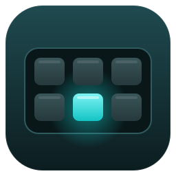

<p align="center"></p>

# KeyBoardLight

**Linux configurator for the Yenkee YKB 30 Odyssey keyboard** – lighting effects, per-key colours,
key remapping, macros and profiles. No Windows, no Wine, everything is stored in the keyboard itself.

**Linuxová aplikace pro nastavení klávesnice Yenkee YKB 30 Odyssey** – efekty podsvícení, barvy jednotlivých
kláves, přemapování kláves, makra a profily. Bez Windows a bez Wine, vše se ukládá přímo do klávesnice.
[Česky níže ↓](#česky)


## Features

| | |
|---|---|
| **Lighting** | all 20 hardware effects, brightness, speed, direction, colour, rainbow – only the controls that apply to the chosen effect are shown |
| **Per-key colours** | click/drag to paint keys, any RGB colour, per-key brightness 0–100 % (selected keys or the whole keyboard) |
| **Keys** | remap any key to another key (with Ctrl/Shift/Alt/Win), a multimedia function, a macro, or disable it |
| **Macros** | record from the keyboard, type text (aware of your system keyboard layout via libxkbcommon), mouse clicks, delays; play once / while held / toggle / N times |
| **Profiles** | save named presets (e.g. *Day*, *Night*) and switch with one click or `keyboardlight --profile Night` (bind it to a hotkey or a timer) |
| **Knob** | the knob always changes volume (fixed in firmware); one click under *More* makes **Ctrl + knob** change the screen brightness (KDE Plasma) |
| **Languages** | English and Czech (follows the system language, switchable under *More*) |
| **Safety** | every write is verified by reading it back; each area is backed up before the first write (`~/.local/share/keyboardlight/backups/`) |

The keyboard must be connected **by USB cable with the switch on the bottom in the wired (TYP-C) position** –
over Bluetooth / 2.4 GHz the configuration interface is not available.

## Install

### CachyOS / Arch Linux – ready-made package
Download the latest `keyboardlight-*-any.pkg.tar.zst` from
**[Releases](https://github.com/brbla/keyboardlight/releases/latest)** and install it:
```sh
sudo pacman -U keyboardlight-*-any.pkg.tar.zst
```

### CachyOS / Arch Linux – build from source
```sh
git clone https://github.com/brbla/keyboardlight.git
cd keyboardlight/packaging/arch
makepkg -si
```
Then unplug and re-plug the keyboard and start **KeyBoardLight** from the application menu.
The package installs a udev rule (`/usr/lib/udev/rules.d/70-keyboardlight.rules`) that gives the logged-in user
access to the keyboard – no root needed afterwards.

### Run from source (any distribution)
Requirements: Python ≥ 3.10, PyQt6, libxkbcommon.
```sh
sudo cp udev/70-keyboardlight.rules /etc/udev/rules.d/
sudo udevadm control --reload && sudo udevadm trigger   # then re-plug the keyboard
./keyboardlight.sh
```

### Command line
```sh
keyboardlight --list-profiles
keyboardlight --profile Night        # apply a saved profile without opening the window
```

## Supported hardware

| Keyboard | USB ID | Status |
|---|---|---|
| Yenkee YKB 30 Odyssey (Telink, 75 %, 82 keys) | `320f:5055` | ✅ supported |
| Evision Kreo Hive and other boards with `320f:5055` | `320f:5055` | likely works (same OEM board), untested |
| AULA 60HE (Hall-effect) | – | planned |

## How it works

The protocol was reverse-engineered on Linux (usbmon captures, a webcam watching the LEDs, and static
analysis of the vendor Windows app). It is documented in **[docs/odyssey-protocol.md](docs/odyssey-protocol.md)**:
64-byte HID reports (report ID 4) on interface 1 – lighting block, per-key colours, default/active key map,
macro block and key-assignment encoding. Helper scripts used during the research are in `tools/`.

Not affiliated with Yenkee / FAST ČR. Use at your own risk – although every write is verified and backed up,
this is unofficial software talking to the keyboard firmware.

## Development
```sh
python -m pytest tests          # unit tests (no keyboard needed)
KEYBOARDLIGHT_LANG=en ./keyboardlight.sh
```
Roadmap: [docs/PLAN.md](docs/PLAN.md).

---

## Česky

**Co umí**
- **Podsvícení:** všech 20 efektů klávesnice, jas, rychlost, směr, barva, duha. Zobrazují se jen volby, které má u daného efektu smysl měnit.
- **Barvy jednotlivých kláves:** klikáním nebo tažením obarvíte klávesy libovolnou barvou, jas 0–100 % pro vybrané klávesy nebo celou klávesnici.
- **Klávesy:** přemapování na jinou klávesu (i s Ctrl/Shift/Alt/Win), multimediální funkci, makro, nebo vypnutí klávesy.
- **Makra:** nahrávání z klávesnice, vložení textu (podle rozložení klávesnice v systému, např. česká QWERTZ), kliknutí myší, prodlevy; přehrát jednou / při držení / přepínač / N-krát.
- **Profily:** uložené předvolby (např. *Den*, *Noc*) a přepínání jedním kliknutím nebo příkazem `keyboardlight --profile Noc`.

- **Knoflík:** otáčení mění vždy hlasitost (dáno firmwarem); jedním tlačítkem na stránce *Další* nastavíte, že **Ctrl + knoflík** mění jas obrazovky (KDE Plasma).

**Instalace na CachyOS / Arch – hotový balíček**
Stáhněte nejnovější `keyboardlight-*-any.pkg.tar.zst` z
**[Releases](https://github.com/brbla/keyboardlight/releases/latest)** a nainstalujte:
```sh
sudo pacman -U keyboardlight-*-any.pkg.tar.zst
```
Nebo ze zdrojů: `git clone https://github.com/brbla/keyboardlight.git && cd keyboardlight/packaging/arch && makepkg -si`
Pak klávesnici odpojte a znovu připojte a spusťte **KeyBoardLight** z nabídky aplikací.
Klávesnice musí být připojená **kabelem** a přepínač na spodní straně musí být v poloze **TYP-C** (drátově).

Aplikace není oficiálním produktem firmy Yenkee / FAST ČR.
